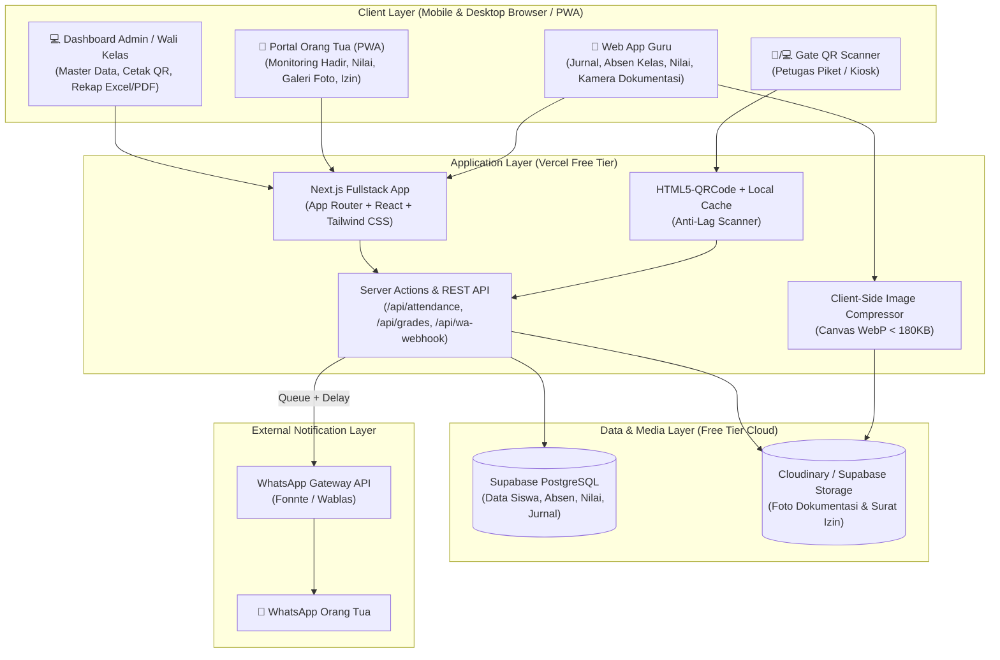
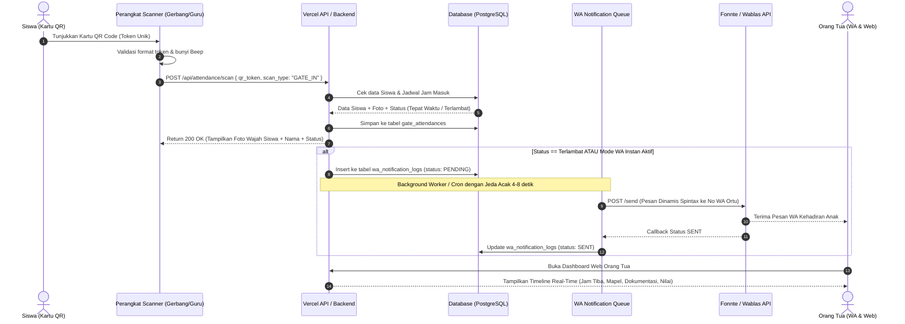
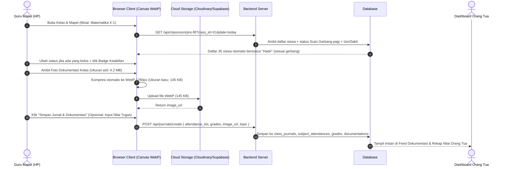
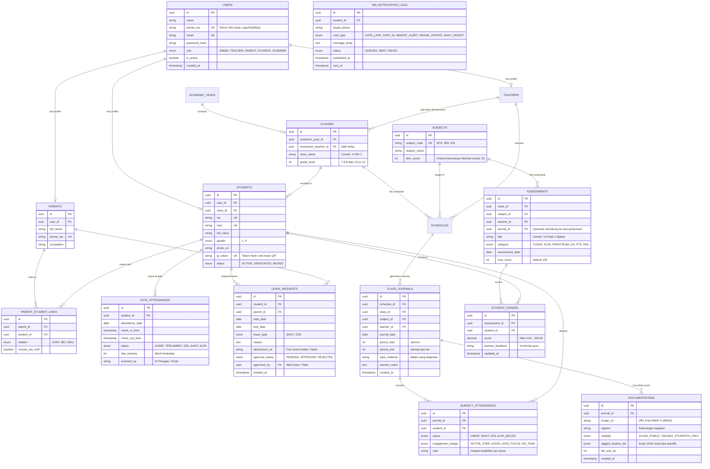

# System Architecture & Technical Specification (`ARCHITECTURE.md`)
## Sistem Informasi Absensi, Nilai, & Dokumentasi Pembelajaran Siswa Terintegrasi Orang Tua

Dokumen ini menjabarkan arsitektur sistem, perbandingan *Tech Stack* gratis (**Vercel** vs **Google Apps Script**), desain skema database (**ERD**), alur data (*Sequence Diagram*), mekanisme kompresi dokumentasi, serta arsitektur antrean **WhatsApp Gateway**.

---

## 1. Perbandingan & Pemilihan Tech Stack Gratis (Free Tier)

Sesuai kebutuhan proyek untuk di-deploy secara **gratis** di **Vercel** atau **Google Apps Script (GAS)**, berikut adalah analisis teknis kedua arsitektur beserta rekomendasi utamanya:

### 1.1 Tabel Perbandingan Arsitektur

| Komponen / Aspek | **Opsi A (REKOMENDASI UTAMA): Modern Cloud Stack (Vercel + Supabase + Cloudinary)** | **Opsi B (ALTERNATIF): Google Workspace Stack (Google Apps Script + Sheets + Drive)** |
| :--- | :--- | :--- |
| **Frontend & Hosting** | **Next.js (App Router) + Tailwind CSS** di-deploy di **Vercel (Free Hobby Plan)** | **HTML/CSS/JS (React via Vite SingleFile)** di-deploy di **Google Apps Script Web App** |
| **Backend / API** | Next.js Server Actions & Route Handlers (Serverless Functions di Vercel) | Fungsi `google.script.run` & `doGet/doPost` pada Google Apps Script |
| **Database Utama** | **Supabase PostgreSQL (Free Tier: 500 MB)** – Sanggup menyimpan >1.500.000 baris data absensi & nilai | **Google Sheets** (Batas maks: 10 juta sel, mulai lambat ketika >5.000 baris) |
| **Penyimpanan Foto Dokumentasi** | **Cloudinary Free Tier (25 GB)** atau **Supabase Storage (1 GB)** + Kompresi WebP (<180 KB/foto) | **Google Drive Folder** (Kuota 15 GB per akun Google gratis) |
| **Kecepatan Scan QR** | **Sangat Cepat (< 300 ms)** – Koneksi langsung ke database indeks PostgreSQL + Local Cache | **Lambat (2 – 4 detik per scan)** – Karena overhead eksekusi Apps Script & pembacaan baris Spreadsheet |
| **Dukungan PWA & Kamera** | **Penuh** (Bisa di-install ke layar utama HP Orang Tua & Guru, akses kamera tanpa kendala iframe) | **Terbatas** (Berjalan di dalam sandboxed `<iframe>` milik `script.googleusercontent.com`) |
| **Batas Kuota Harian** | Bandwidth 100 GB/bulan di Vercel (Sangat lega untuk sekolah menengah/besar) | Eksekusi skrip maksimal **90 menit/hari** & maksimal **30 pengguna bersamaan** |
| **Kesimpulan Penggunaan** | **Paling Optimal** untuk sekolah umum (100 – 1.500 siswa), cepat, profesional, dan tetap 100% gratis. | Cocok jika sekolah hanya memiliki <150 siswa atau ingin seluruh datanya langsung berbentuk Spreadsheet. |

> [!TIP]
> **Rekomendasi Arsitektur Hybrid Terbaik:**  
> Gunakan **Opsi A (Next.js di Vercel + Supabase PostgreSQL + Cloudinary)** sebagai sistem utama agar aplikasi sangat cepat saat Scan QR dan nyaman dibuka oleh Orang Tua, lalu tambahkan **Fitur Export / Sinkronisasi 1-Klik ke Google Sheets / Excel** untuk staf TU yang gemar mengolah data di Spreadsheet.
> *(Catatan: Di bagian bawah dokumen ini juga disertakan panduan struktur jika Anda tetap ingin mengeksekusi Opsi B di Google Apps Script).*

---

## 2. Diagram Arsitektur Tingkat Tinggi (High-Level Architecture)



---

## 3. Alur Sistem Utama (Sequence Diagrams)

### 3.1 Alur Scan QR Code Siswa & Notifikasi WhatsApp Anti-Banned
Diagram berikut menjelaskan bagaimana proses Scan QR bekerja dalam hitungan milidetik sekaligus mencegah pemblokiran nomor WhatsApp sekolah:



### 3.2 Alur Input Jurnal, Nilai, & Kompresi Foto Dokumentasi oleh Guru



---

## 4. Desain Skema Database & Entity Relationship Diagram (ERD)

Skema database dirancang menggunakan **Relasi Many-to-Many** antara Orang Tua dan Siswa (mendukung orang tua yang memiliki >1 anak di sekolah yang sama), serta memisahkan **Absensi Gerbang Harian** dengan **Absensi Jurnal Mata Pelajaran**.



---

## 5. Detail Teknis Modul Krusial

### 5.1 Spesifikasi Teknis QR Code & Anti-Titip Absen
1. **Struktur Payload QR Code:**
   - Jangan gunakan NIS mentah (misal `2026001`) karena siswa mudah membuat barcode palsu menggunakan generator online untuk menjahili temannya.
   - Gunakan format **Signed Token Pendek**: `SHD.<student_short_id>.<hmac_signature_8char>` (contoh: `SHD.8f92a1.c49b01e2`).
   - Panjang karakter sekitar 20 karakter membuat matriks QR Code memiliki kerapatan rendah (*Low Density*), sehingga **sangat cepat terbaca oleh kamera HP murah sekalipun** dari jarak 20–30 cm.
2. **Alur Cooldown & Duplikasi Scan:**
   - Jika siswa yang sama men-scan kartu 2 kali berturut-turut dalam waktu `< 5 menit`, sistem mengabaikan scan kedua dan menampilkan pesan *"Sudah tercatat hadir pada pukul 06:54"*.
   - Scan di bawah jam `11:00` otomatis masuk sebagai `check_in_time` (Kedatangan), sedangkan scan di atas jam `13:00` (atau sesuai pengaturan jam pulang sekolah) otomatis mengisi `check_out_time` (Kepulangan).

### 5.2 Spesifikasi Kompresi Dokumentasi (Client-Side Image Compression)
Agar penyimpanan gratis tidak pernah penuh, pengunggahan foto pada form Guru maupun form Surat Izin Orang Tua wajib melewati pipeline berikut di sisi browser:
```typescript
// Spesifikasi Parameter Kompresi Gambar di Browser sebelum Upload
const compressionOptions = {
  maxSizeMB: 0.18,          // Maksimal 180 KB per foto
  maxWidthOrHeight: 1280,   // Resolusi HD 1280px (sangat tajam di layar HP & Laptop)
  useWebWorker: true,       // Tidak membuat UI browser macet/freeze
  fileType: 'image/webp',   // Format WebP hemat ukuran 70% dibanding JPEG
  initialQuality: 0.78      // Kualitas visual optimal
};
```
**Perhitungan Kapasitas Gratis:**
- Dengan rata-rata `150 KB` per foto:
  - **Supabase Storage Gratis (1 GB):** Muat sekitar **~6.800 foto dokumentasi**.
  - **Cloudinary Gratis (25 GB):** Muat sekitar **~160.000 foto dokumentasi** (cukup untuk >5 tahun operasional sekolah tanpa biaya sepeser pun).

### 5.3 Integrasi WhatsApp Gateway & Mekanisme Anti-Banned
Menggunakan penyedia gateway lokal ramah kantong/gratis trial seperti **Fonnte** atau **Wablas**:
- **Payload Pengiriman Webhook:**
  - Mendukung pengiriman pesan dengan parameter `delay: "4-10"` (Fonnte memiliki fitur bawaan jeda acak di sisi server mereka jika dikirim sekaligus).
- **Template Pesan Spintax (Variasi Otomatis):**
  ```text
  {Assalamu'alaikum|Selamat Pagi|Halo} Bapak/Ibu {nama_ortu},
  Kami menginformasikan bahwa putra/putri Anda:
  👤 Nama: *{nama_siswa}* ({kelas})
  🕒 Waktu Scan: {jam_scan} WIB
  📌 Status: *{status_kehadiran}*
  
  Pantau foto dokumentasi belajar & nilai harian melalui portal orang tua:
  🔗 {link_portal_ortu}
  ```

---

## 6. Struktur Direktori Project (Project Directory Structure)

### 6.1 Struktur Project untuk Opsi A (Next.js App Router - Deploy di Vercel)
```text
d:\WEBSITE ABSENSI\
├── prisma/
│   ├── schema.prisma              # Skema Database PostgreSQL (Supabase)
│   └── seed.ts                    # Data awal (Admin, Contoh Kelas, Siswa, Ortu)
├── public/
│   ├── manifest.json              # Konfigurasi PWA (Agar bisa di-install di HP)
│   ├── sounds/
│   │   ├── beep-success.mp3       # Efek suara scan QR berhasil
│   │   └── beep-error.mp3         # Efek suara scan QR gagal / tidak dikenal
│   └── icons/
├── src/
│   ├── app/
│   │   ├── (auth)/
│   │   │   └── login/             # Login Guru, Admin, & Orang Tua (No WA + PIN)
│   │   ├── (scanner)/
│   │   │   └── gate-scanner/      # Layar Kiosk/Piket Scan QR Code Gerbang
│   │   ├── (teacher)/
│   │   │   ├── dashboard/         # Jadwal mengajar hari ini
│   │   │   ├── journal/[id]/      # Absen kelas + Keaktifan + Upload Dokumentasi
│   │   │   └── grades/            # Input & rekap nilai (Tugas, UH, PTS, PAS)
│   │   ├── (parent)/
│   │   │   ├── parent-dashboard/  # Timeline anak hari ini + Child Switcher
│   │   │   ├── documentations/    # Feed galeri foto kegiatan kelas anak
│   │   │   ├── grades-report/     # Riwayat nilai & keaktifan belajar anak
│   │   │   └── leave-request/     # Form pengajuan Izin / Sakit + upload surat
│   │   ├── (admin)/
│   │   │   ├── master-data/       # CRUD Siswa, Ortu, Guru, Kelas, Mapel, Import Excel
│   │   │   ├── qr-cards/          # Generator cetak kartu QR siswa massal (PDF)
│   │   │   ├── recap-attendance/  # Matriks rekap absensi bulanan & export Excel/PDF
│   │   │   └── wa-settings/       # Konfigurasi WhatsApp Gateway & log pesan
│   │   └── api/
│   │       ├── attendance/scan/   # Endpoint super cepat pencatatan QR Code
│   │       ├── upload/            # Endpoint tanda tangan upload foto dokumentasi
│   │       └── cron/wa-digest/    # Endpoint pengiriman rangkuman WA harian
│   ├── components/
│   │   ├── qr/                    # Komponen Kamera QR Scanner & Kartu QR Cetak
│   │   ├── media/                 # Komponen Camera Capture + WebP Compressor
│   │   ├── charts/                # Grafik tren kehadiran & nilai siswa
│   │   └── ui/                    # Komponen dasar (Button, Badge, Modal, Table)
│   └── lib/
│       ├── db.ts                  # Koneksi Prisma Client
│       ├── auth.ts                # Manajemen Sesi & Role-Based Access Control
│       ├── image-compression.ts   # Utilitas kompresi foto <180KB
│       ├── whatsapp.ts            # Integrasi Fonnte/Wablas + Spintax Formatter
│       └── export-excel-pdf.ts    # Generator laporan Excel (.xlsx) & PDF
├── PRD.md
├── ARCHITECTURE.md
├── DESIGN.md
└── WORKFLOW.md
```

### 6.2 Catatan Arsitektur Jika Menggunakan Opsi B (Google Apps Script)
Apabila di masa depan Anda ingin membuat versi ringan khusus untuk **Google Apps Script + Google Sheets**, struktur datanya disederhanakan menjadi:
- **1 File Google Spreadsheet** dengan 9 Sheet: `Users`, `Students`, `Parents`, `Classes_Subjects`, `Gate_Attendances`, `Class_Journals`, `Subject_Attendances`, `Grades`, dan `Documentations`.
- **1 Folder Google Drive** khusus untuk menampung file WebP hasil kompresi (disimpan menggunakan `DriveApp.getFolderById(FOLDER_ID).createFile(blob)` dan diambil URL thumbnail-nya `https://drive.google.com/thumbnail?id=FILE_ID&sz=w1000`).
- **Optimasi Wajib di GAS:** Gunakan `CacheService.getScriptCache()` untuk menyimpan daftar siswa dan token QR selama 6 jam agar saat scan QR tidak perlu membaca seluruh baris Google Sheets berulang kali.

