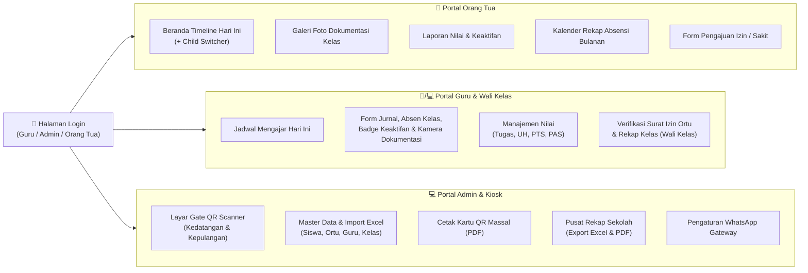

# UI/UX Design Specification & Wireframes (`DESIGN.md`)
## Sistem Informasi Absensi, Nilai, & Dokumentasi Pembelajaran Siswa Terintegrasi Orang Tua

Dokumen ini menetapkan standar desain antarmuka (*Design System*), hierarki warna, tipografi, serta rancangan tata letak (*Wireframes*) untuk setiap peran pengguna agar aplikasi mudah digunakan oleh Orang Tua, Guru di kelas, maupun Admin Tata Usaha.

---

## 1. Prinsip Utama Desain (Core Design Principles)

1. **Mobile-First untuk Orang Tua & Guru, Desktop-First untuk Admin:**
   - **Orang Tua** mengakses web melalui tautan WhatsApp atau ikon PWA di layar HP. Navigasi wajib menggunakan **Bottom Navigation Bar** (mudah dijangkau ibu jari).
   - **Guru** mengisi jurnal, memvalidasi absen kelas, memotret dokumentasi, dan memberi badge keaktifan sambil berdiri/duduk di kelas menggunakan HP. Tombol aksi harus berukuran minimal `44px × 44px` (*touch-friendly*).
   - **Admin & Wali Kelas** melihat tabel matriks tanggal `1 s/d 31` dan meng-export Excel/PDF menggunakan layar Laptop/PC dengan **Sidebar Navigation**.
2. **Zero Cognitive Load (Sekali Lihat Langsung Paham):**
   - Saat Orang Tua membuka aplikasi, pertanyaan utama mereka adalah: *"Apakah anak saya sudah sampai di sekolah hari ini, sedang belajar apa, dan bagaimana nilainya?"*. Jawaban tersebut wajib langsung terlihat di **3 detik pertama** tanpa perlu membuka menu berlapis.
3. **High-Contrast Status Indicators:**
   - Setiap status kehadiran dan nilai memiliki kode warna dan ikon konsisten agar pengguna yang kurang akrab dengan teknologi sekalipun (termasuk orang tua lanjut usia) langsung mengerti.

---

## 2. Sistem Warna & Tipografi (Color Palette & Typography)

### 2.1 Palet Warna Utama (Tailwind CSS Standard)
| Kategori | Peran Warna | Kode Hex | Kelas Tailwind | Penggunaan |
| :--- | :--- | :--- | :--- | :--- |
| **Primary** | Pendidikan & Kepercayaan | `#2563EB` | `blue-600` | Header, Tombol Utama, Navigasi Aktif |
| **Background** | Bersih & Ramah Mata | `#F8FAFC` | `slate-50` | Latar belakang utama halaman |
| **Surface / Card** | Kontainer Informasi | `#FFFFFF` | `white` | Kartu status anak, kartu dokumentasi, tabel |
| **Text Primary** | Keterbacaan Tinggi | `#0F172A` | `slate-900` | Judul, Nama Siswa, Nilai Angka |
| **Text Secondary**| Informasi Pendukung | `#475569` | `slate-600` | Jam absen, nama guru, keterangan foto |

### 2.2 Semantic Badges (Kode Warna Status Absensi & Akademik)
| Status | Kode Singkat | Warna Utama | Latar Badge | Ikon & Arti Visual |
| :--- | :---: | :--- | :--- | :--- |
| **Hadir Tepat Waktu** | `H` | `#059669` (`emerald-600`) | `#D1FAE5` (`emerald-100`) | `✅ Hadir` (Aman / Sesuai Jadwal) |
| **Terlambat** | `T` | `#D97706` (`amber-600`) | `#FEF3C7` (`amber-100`) | `⏰ Terlambat (+15m)` (Peringatan Ringan) |
| **Izin** | `I` | `#0284C7` (`sky-600`) | `#E0F2FE` (`sky-100`) | `📩 Izin Terkonfirmasi` (Informasi Netral) |
| **Sakit** | `S` | `#7C3AED` (`violet-600`) | `#EDE9FE` (`violet-100`) | `🏥 Sakit (Surat Dokter)` (Perhatian Medis) |
| **Alpa / Bolos** | `A` | `#E11D48` (`rose-600`) | `#FFE4E6` (`rose-100`) | `🚨 Tanpa Keterangan / Bolos` (Bahaya/Prioritas) |

### 2.3 Tipografi
- **Font Utama (UI & Teks):** `Plus Jakarta Sans` atau `Inter` (sangat jelas di layar HP Android maupun iOS).
- **Font Angka / Tabel / Kode QR:** `JetBrains Mono` atau `tabular-nums` (agar angka jam absensi `06:55`, nilai `88.5`, dan matriks rekap sejajar vertikal).

---

## 3. Rancangan Tata Letak Layar Utama (Wireframes)

### 3.1 Portal Orang Tua – Dashboard Utama (Mobile View)
Menampilkan pemilih anak (*Child Switcher*), ringkasan kehadiran hari ini, timeline mata pelajaran beserta bukti foto dokumentasi kelas, dan nilai terbaru.

```text
+-------------------------------------------------------+
| 🏫 SMAN 1 HARAPAN BANGSA                    [🔔 2]    |
|-------------------------------------------------------|
| 👨‍👩‍👧‍👦 Pilih Anak: [ 👦 Budi Santoso (X-IPA-1) ▼ ]       |
|                 (Opsi lain: 👧 Siti Aminah - VII-B)   |
+-------------------------------------------------------+
| STATUS KEHADIRAN HARI INI (Rabu, 4 Nov 2026)          |
| +---------------------------------------------------+ |
| | ✅ HADIR TEPAT WAKTU                              | |
| | 📥 Scan Masuk Gerbang : 06:48 WIB                 | |
| | 📤 Scan Pulang Gerbang: --:-- WIB (Belum Pulang)  | |
| | 📊 Kehadiran Bulan Ini: 96% (22 Hadir, 1 Sakit)   | |
| +---------------------------------------------------+ |
|                                                       |
| [ 📝 Ajukan Izin / Sakit ]   [ 🪪 Lihat Kartu QR ]    |
|                                                       |
| ----------------------------------------------------- |
| 📚 AKTIVITAS BELAJAR & DOKUMENTASI HARI INI           |
|                                                       |
| ● 07:15 - 08:45 | Matematika (Bpk. Hendra, S.Pd)      |
| | Status di Kelas: [✅ Hadir]  [🌟 Aktif Bertanya]    |
| | Materi: Persamaan Kuadrat & Fungsi Grafik           |
| | +-----------------------------------------------+   |
| | | [🖼️ FOTO DOKUMENTASI KELAS - WebP 140KB]      |   |
| | | "Siswa mengerjakan latihan soal di papan"     |   |
| | +-----------------------------------------------+   |
| | 🏆 Nilai Kuis Harian: 90 / 100 (Tuntas KKM 75)      |
| | 💬 Catatan Guru: "Budi maju mengerjakan soal no 3"  |
| |                                                     |
| ● 08:45 - 10:15 | Fisika (Ibu Ratna, M.Pd)            |
| | Status di Kelas: [✅ Hadir]  [✅ Mengikuti Baik]    |
| | Materi: Praktikum Pengukuran Jangka Sorong          |
| | +-----------------------------------------------+   |
| | | [🖼️ FOTO DOKUMENTASI PRAKTIKUM LAB]           |   |
| | +-----------------------------------------------+   |
|                                                       |
+-------------------------------------------------------+
| [🏠 Beranda]  [📸 Dokumentasi]  [📊 Nilai]  [📅 Rekap]|
+-------------------------------------------------------+
```

---

### 3.2 Layar Guru – Input Jurnal Kelas, Absensi, Keaktifan & Dokumentasi (Mobile/Tablet)
Dirancang agar guru dapat menyelesaikan seluruh administrasi kelas **kurang dari 2 menit**.

```text
+-------------------------------------------------------+
| ← Kembali   JURNAL & ABSENSI KELAS          [Simpan]  |
|-------------------------------------------------------|
| 📍 Kelas: X-IPA-1  | 📘 Mapel: Matematika (Jam 1-2)   |
| 📅 Rabu, 4 Nov 2026 | 👥 Total: 32 Siswa              |
+-------------------------------------------------------+
| 1. MATERI & DOKUMENTASI KEGIATAN KELAS                |
| Topik Materi Hari Ini:                                |
| [ Persamaan Kuadrat & Latihan Soal Kelompok         ] |
|                                                       |
| Bukti Foto Pembelajaran (Otomatis Kompres <180KB):    |
| +-------------------+  +-------------------+          |
| | 📷 Ambil Foto     |  | 🖼️ foto_kelas.webp| [x]      |
| | Kamera Langsung   |  | (132 KB - Terkompresi)       |
| +-------------------+  +-------------------+          |
| Keterangan Foto: [ Diskusi kelompok baris depan     ] |
| Visibilitas: (•) Semua Ortu Kelas  ( ) Tag Siswa Saja |
+-------------------------------------------------------+
| 2. VERIFIKASI ABSEN & KEAKTIFAN SISWA                 |
| 💡 Otomatis terisi dari Scan QR Gerbang Pagi          |
| [🔍 Cari Siswa...]         [📷 Scan QR Siswa di Kelas]|
|                                                       |
| Ringkasan: [Hadir: 30] [Sakit: 1] [Izin: 1] [Alpa: 0] |
| ----------------------------------------------------- |
| 1. Ahmad Fauzi (NIS: 1021) - Scan Gerbang: 06:50      |
|    Absen : [(H) Hadir] [ S ] [ I ] [ A/Bolos ]        |
|    Respon: [🌟 Aktif] [(✅ Baik)] [⚠️ Kurang] [❌ Tugas]|
|    Nilai Cepat (Opsional): [ 85 ]  [+ Catatan]        |
| ----------------------------------------------------- |
| 2. Budi Santoso (NIS: 1022) - Scan Gerbang: 06:48     |
|    Absen : [(H) Hadir] [ S ] [ I ] [ A/Bolos ]        |
|    Respon: [(🌟 Aktif)] [✅ Baik] [⚠️ Kurang] [❌ Tugas]|
|    Nilai Cepat (Opsional): [ 90 ]  "Maju ke depan"    |
| ----------------------------------------------------- |
| 3. Citra Lestari (NIS: 1023) - [🏥 Surat Sakit Ortu]  |
|    Absen : [ H ] [(S) Sakit] [ I ] [ A/Bolos ]        |
|    [Lihat Foto Surat Dokter dari Orang Tua]           |
+-------------------------------------------------------+
|        [ 💾 SIMPAN JURNAL, ABSEN & DOKUMENTASI ]      |
+-------------------------------------------------------+
```

---

### 3.3 Layar Scanner QR Code Gerbang / Kiosk (Tablet / Laptop / HP Piket)
Dilengkapi pencegahan **Titip Absen** melalui tampilan Foto Profil Siswa berukuran besar dan riwayat 5 scan terakhir di sebelah kanan.

```text
+-----------------------------------------------------------------------+
| 🏫 GATE QR SCANNER - ABSENSI KEDATANGAN PAGI         🕒 06:54:12 WIB  |
| Mode: [📥 Kedatangan (06:00-07:15)]  [📤 Kepulangan]  [🔊 Suara: ON]  |
+-----------------------------------+-----------------------------------+
|                                   |  HASIL VERIFIKASI SCAN TERAKHIR   |
|   +---------------------------+   |  +-----------------------------+  |
|   |                           |   |  |      [ FOTO PROFIL ]        |  |
|   |     [ KAMERA LIVE /       |   |  |      [ SISWA BESAR ]        |  |
|   |       QR VIEWFINDER ]     |   |  |      (Pastikan Wajah        |  |
|   |                           |   |  |       Sesuai Pembawa!)      |  |
|   |        +---------+        |   |  +-----------------------------+  |
|   |        |  [QR]   |        |   |  Nama  : BUDI SANTOSO             |
|   |        +---------+        |   |  Kelas : X - IPA - 1              |
|   |                           |   |  Waktu : 06:54:10 WIB             |
|   +---------------------------+   |  Status: [ ✅ HADIR TEPAT WAKTU ] |
|   💡 Arahkan Kartu QR ke Kamera   |  Notif : 💬 Terjadwal ke WA Ortu  |
|   atau gunakan Scanner USB 2D     |                                   |
|                                   |  RIWAYAT SCAN BARU SAJA:          |
|   Input Manual NIS (Jika Kartu    |  1. 06:54 - Budi S. (X-IPA-1) ✅  |
|   Rusak/Tertinggal):              |  2. 06:53 - Rina W. (XI-IPS-2) ✅ |
|   [ Masukkan NIS... ] [Catat]     |  3. 06:53 - Dedi K. (XII-1) ✅    |
+-----------------------------------+-----------------------------------+
```

---

### 3.4 Layar Admin & Wali Kelas – Matriks Rekap Absensi & Nilai (Desktop View)
Menyajikan rekapitulasi bulanan yang siap di-export ke Excel dan PDF resmi sekolah.

```text
+-----------------------------------------------------------------------------------+
| 📊 REKAPITULASI ABSENSI & KETERLIBATAN SISWA                                      |
| Filter: [Tahun: 2026/2027 Ganjil ▼] [Kelas: X-IPA-1 ▼] [Bulan: November 2026 ▼]   |
|                                       [📥 Export Excel (.xlsx)] [🖨️ Cetak PDF]   |
+-----------------------------------------------------------------------------------+
| No | Nama Siswa   | 01 | 02 | 03 | 04 | ... | 30 | H  | S | I | A | T | % Hadir   |
|----|--------------|----|----|----|----|-----|----|----|---|---|---|---|-----------|
| 1  | Ahmad Fauzi  | H  | H  | H  | H  | ... | H  | 24 | 0 | 0 | 0 | 1 | 100.0% 🟢 |
| 2  | Budi Santoso | H  | H  | S  | H  | ... | H  | 23 | 1 | 0 | 0 | 0 |  95.8% 🟢 |
| 3  | Citra Lestari| H  | I  | S  | S  | ... | H  | 21 | 2 | 1 | 0 | 0 |  87.5% 🟡 |
| 4  | Doni Pratama | A  | H  | T  | A  | ... | A  | 18 | 0 | 0 | 4 | 3 |  75.0% 🔴 |
+-----------------------------------------------------------------------------------+
| ⚠️ PERINGATAN DINI (EARLY WARNING SYSTEM):                                        |
| • Doni Pratama tercatat 4x Alpa & 3x Terlambat bulan ini -> [💬 Kirim WA Panggilan]|
+-----------------------------------------------------------------------------------+
```

---

### 3.5 Desain Kartu Pelajar QR Code Siap Cetak (Generator PDF Admin)
Format ukuran standar kartu ID (`85.6 mm × 54 mm`), 1 halaman A4 memuat 8–10 kartu siswa:

```text
+---------------------------------------------------+
| 🏫 PEMERINTAH PROVINSI / YAYASAN PENDIDIKAN       |
|    SMA NEGERI 1 HARAPAN BANGSA                    |
|---------------------------------------------------|
| +----------+  NAMA : BUDI SANTOSO                 |
| |   FOTO   |  NISN : 0081234567 / NIS: 261022     |
| |  SISWA   |  KELAS: X - IPA - 1                  |
| |   3x4    |                                      |
| +----------+  +---------+  Scan QR ini untuk      |
|               | [QR CODE|  Absensi Kehadiran &    |
|               |  TOKEN] |  Koneksi Portal Ortu    |
|               +---------+  SHD.8f92a1.c49b01e2    |
+---------------------------------------------------+
```

---

## 4. Alur Navigasi Pengguna (Sitemap Diagram)



